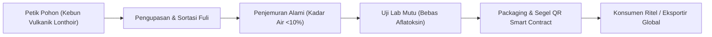
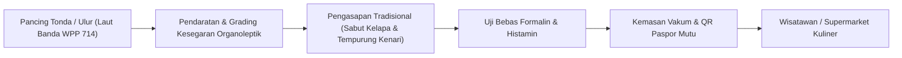

# DOKUMEN REQUIREMENTS DAN PEMETAAN RANTAI PASOK MULTI-KOMODITAS
## Sistem Ketertelusuran Berbasis Blockchain Ekosistem Digital Banda Neira
**Spesialis:** Khoirul Anam (*Blockchain & Traceability Specialist*)  
**Wilayah Implementasi:** Kepulauan Banda, Maluku Tengah  
**Komoditas Inti:** Rempah (Pala Banda, Fuli Merah, Cengkeh) & Perikanan (Ikan Cakalang, Tuna Sirip Kuning, Ikan Asar Tradisional)

---

## 1. Latar Belakang & Urgensi Wilayah

Kepulauan Banda di Maluku Tengah memiliki keunikan sosio-ekologis ganda:
1. **Sektor Agraris Rempah:** Pusat historis pala (*Myristica fragrans*) dunia dengan sertifikasi Indikasi Geografis (IG) "Pala Banda" sejak 2014. Namun, petani kerap mengalami depresiasi harga akibat percampuran pala asalan (*off-grade*) dari luar pulau oleh tengkulak, cemaran aflatoksin, serta pemalsuan asal-usul di pasar ekspor.
2. **Sektor Bahari Perikanan:** Wilayah laut Banda (WPPNRI 714) merupakan lintasan migrasi pelagis bernilai tinggi (*Yellowfin Tuna* dan Cakalang). Nelayan tradisional Banda mengolah ikan menggunakan teknik pengasapan kayu kenari (*Ikan Asar*) yang bernilai kuliner tinggi. Tantangannya adalah ketiadaan sertifikasi rantai dingin (*cold chain*) dan jaminan keaslian bebas formalin/bahan kimia berbahaya bagi wisatawan dan pembeli antarpulau.

Sistem ketertelusuran digital berbasis PostGIS dan Blockchain EVM memecahkan persoalan ini dengan menciptakan **Paspor Digital Komoditas Banda** yang membuktikan keaslian asal petak kebun/zona tangkap, metode pascapanen/pengolahan, dan integritas sertifikasi tanpa pihak ketiga terpusat.

---

## 2. Taksonomi Aktor & Stakeholder Matrix

| ID Aktor | Nama Peran | Deskripsi Operasional | Hak Akses Sistem | Komoditas yang Dikelola |
|---|---|---|---|---|
| **ACT-01** | **Petani Rempah** | Anggota kelompok tani desa yang menggarap petak kebun pala/cengkeh di lereng vulkanik (Lonthoir, Selamon, Boiyauw). | Input panen, logging kadar air, request verifikasi batch. | Buah pala gelondong, fuli basah, cengkeh petik. |
| **ACT-02** | **Nelayan Tradisional** | Nelayan pancing tonda/ulur anggota KUB Bahari di Nusantara, Dender, atau Pulau Hatta. | Input hasil tangkap harian, koordinat zona tangkap, suhu palka/es. | Ikan cakalang segar, tuna sirip kuning grade sashimi. |
| **ACT-03** | **Kelompok Tani / KUB Nelayan** | Lembaga kooperatif tingkat desa yang mengoordinasikan penimbangan komunal dan pengeringan/penyimpanan terpadu. | Konsolidasi panen, pembentukan batch awal, review kepatuhan internal. | Seluruh komoditas mentah anggota. |
| **ACT-04** | **Petugas Verifikator Desa (Admin)** | Operator pemerintah desa / surveyor lapangan bersertifikat IG. | Inspeksi fisik, validasi poligon PostGIS, anchoring bukti ke smart contract. | Multi-komoditas desa. |
| **ACT-05** | **UMKM / Pengolah Pangan** | Pengrajin lokal olahan rempah (sirup pala, manisan) dan pengasapan ikan (Ikan Asar Lonthoir). | Pencatatan event pengolahan (smoking, boiling, sorting), transfer kepemilikan batch. | Fuli kering, biji kupas Grade A, sirup pala, Ikan Asar. |
| **ACT-06** | **Konsumen / Wisatawan / Buyer** | Pembeli ritel di marketplace desa atau importir rempah luar negeri. | Scan QR batch via kamera ponsel, verifikasi on-chain audit trail publik (Zero-Auth). | Seluruh produk kemasan ber-QR. |

---

## 3. Pemetaan Alur Rantai Pasok (Supply Chain Stages)

### 3.1. Rantai Pasok Rempah Pala & Fuli (Spice Supply Chain)

1. **Tahap 1 - Pemetikan Panen (*Harvesting*):** Pemetikan buah pala ranum menggunakan galah tradisi (*gancu*). Petani mencatat tanggal petik, estimasi bobot, dan menautkannya ke polygon petak kebun terdaftar di PostGIS.
2. **Tahap 2 - Pengupasan Kulit & Pemisahan Fuli (*De-husking & Grading*):** Pemisahan biji cangkang hitam dan fuli merah. Fuli berkualitas utuh dipisahkan untuk grade ekspor.
3. **Tahap 3 - Pengeringan (*Curing & Drying*):** Penjemuran di para-para bambu selama 5–7 hari hingga kadar air di bawah 10% dan biji berbunyi saat diguncang.
4. **Tahap 4 - Uji Mutu & Kurasi (*Quality Assurance*):** Pengujian aflatoksin, kadar minyak atsiri, dan sertifikasi bebas jamur oleh balai uji atau dinas pertanian.
5. **Tahap 5 - Agregasi Batch & Cetak QR (*Batch Aggregation & Minting*):** Pembentukan nomor batch unik (misal: `BN-BTC-2026-001`), penghitungan SHA-256, pengunggahan metadata sertifikat ke IPFS, dan pencatatan hash di smart contract.

---

### 3.2. Rantai Pasok Perikanan Laut & Ikan Asar (Marine Supply Chain)

1. **Tahap 1 - Penangkapan Ramah Lingkungan (*Handline Catch*):** Nelayan menangkap cakalang/tuna satu per satu dengan pancing ulur tanpa bom atau pukat harimau. Pencatatan koordinat GPS laut lepas dan waktu tangkap.
2. **Tahap 2 - Pendaratan Ikan (*Landing & Handling*):** Ikan didaratkan di dermaga desa, dicek kesegaran insang, mata bening, dan elastisitas daging.
3. **Tahap 3 - Pengasapan Tradisional (*Traditional Smoking*):** Ikan dibelah dan dijepit bambu, diasapi di atas bara tempurung kenari dan sabut kelapa selama 4–6 jam pada suhu terkontrol (65–80°C).
4. **Tahap 4 - Verifikasi Higienitas (*Sanitation Certification*):** Inspeksi formalin, boraks, dan histamin dengan sertifikat uji dari dinas perikanan.
5. **Tahap 5 - Kemasan Vakum & Paspor Blockchain (*Vacuum Packing & Anchoring*):** Pemberian label QR code yang memuat identitas nelayan, kapal, waktu asar, dan hash audit trail.

---

## 4. Critical Tracking Events (CTE) & Key Data Elements (KDE)

Mengadopsi kerangka kerja global **GS1 Traceability Standard & FDA FSMA Rule 204**:

| Kode CTE | Nama Event | Lokasi Event | Key Data Elements (KDEs) yang Wajib Dicatat | Bukti Pendukung (Off-Chain IPFS) |
|---|---|---|---|---|
| **CTE-01** | `HARVEST_LOGGED` | Petak kebun petani terdaftar (PostGIS) | ID Panen, NIK Petani (tersamar), ID Petak, Komoditas, Bobot Panen (kg), Tanggal Petik. | Foto timbangan, geolokasi foto GPS. |
| **CTE-02** | `CATCH_LOGGED` | Zona perairan laut Banda (WPP 714) | ID Tangkapan, ID Nelayan, Nama Perahu, Koordinat Laut, Spesies Ikan, Suhu Es Palka (°C). | Foto hasil tangkapan di atas kapal. |
| **CTE-03** | `BATCH_INITIALIZED` | Gudang Koperasi / Balai Desa | Kode Batch (`batch_code`), Token Verifikasi Publik, Bobot Total, Grade Mutu. | Berita Acara Penerimaan Komoditas. |
| **CTE-04** | `PROCESSING_EVENT` | Pengeringan / Rumah Pengasapan | Jenis Proses (Jemur/Asap/Sortir), Durasi (jam/hari), Suhu Rata-rata, Kadar Air Akhir (%). | Log harian ruang pengering/asap. |
| **CTE-05** | `LAB_QUALITY_CERTIFIED` | Laboratorium Uji Mutu / Balai POM | Nomor Sertifikat Uji, Status Bebas Aflatoksin / Formalin, Kadar Minyak / Histamin. | PDF Sertifikat Uji Mutu Terakreditasi. |
| **CTE-06** | `CUSTODY_TRANSFERRED` | Titik Serah Terima / UMKM | Pemilik Lama (Ethereum Address), Pemilik Baru, Lokasi Serah Terima, Tanggal Transfer. | Nota serah terima barang digital. |
| **CTE-07** | `BLOCKCHAIN_ANCHORED` | EVM Node Network (Sepolia / Amoy) | TxHash, Block Number, Root Merkle Event Hash, IPFS CID Metadata. | On-chain Transaction Receipt. |

---

## 5. Analisis Kebutuhan Fungsional (Functional Requirements)

1. **FR-TRC-01 (Multi-Commodity Support):** Sistem wajib membedakan aturan validasi mutu rempah (kadar air, kadar biji keriput) dan hasil laut (kesegaran, histamin, bebas bahan kimia berbahaya).
2. **FR-TRC-02 (Zero-PII On-Chain):** Data pribadi warga (NIK, nomor telepon, alamat rumah terinci) DILARANG diunggah ke blockchain. Blockchain hanya menyimpan SHA-256 hash event, IPFS CID dokumen publik, nomor batch, dan status verifikasi.
3. **FR-TRC-03 (Offline-First Mobile Input):** Petani dan nelayan di area tanpa sinyal seluler dapat menginput data panen/tangkapan ke IndexedDB browser, yang otomatis tersinkronisasi saat terhubung internet.
4. **FR-TRC-04 (Public Verification Portal):** Konsumen tanpa aplikasi khusus dapat memindai QR code via kamera smartphone standar untuk membuka paspor mutu web yang menampilkan rantai peristiwa terverifikasi.
5. **FR-TRC-05 (Cryptographic Tamper Detection):** Jika terdapat modifikasi data sekecil apapun pada basis data lokal, fungsi verifikasi on-chain smart contract harus mendeteksi ketidakcocokan hash (`HASH_MISMATCH_TAMPERED`).
6. **FR-TRC-06 (Decentralized Marketplace Showcase):** Konsumen dapat melihat katalog produk rempah dan olahan ikan terverifikasi, melihat transparansi asal desa dan nama petani, serta memverifikasi hash langsung dengan 1 klik.

---

## 6. Analisis Kebutuhan Non-Fungsional (Non-Functional Requirements)

1. **NFR-SEC-01 (Immutability):** Log peristiwa ketertelusuran yang telah di-anchor ke smart contract bersifat append-only dan tidak dapat diubah atau dihapus oleh siapapun, termasuk administrator sistem.
2. **NFR-PERF-01 (Verification Latency):** Waktu respons verifikasi QR publik dari pemindaian hingga halaman sertifikat tampil tidak boleh melebihi 1,5 detik pada koneksi seluler 4G.
3. **NFR-GAS-01 (Gas Efficiency):** Smart contract dirancang mengoptimalkan penyimpanan byte calldata sehingga biaya gas per anchoring batch tidak melebihi 85.000 gas limit.
4. **NFR-COMP-01 (W3C & GS1 Compliance):** Skema JSON metadata yang disimpan di IPFS wajib kompatibel dengan spesifikasi GS1 EPCIS 2.0 dan W3C Verifiable Credentials.

---

*Disetujui untuk diimplementasikan pada Arsitektur Blockchain Banda Digital Ecosystem.*
