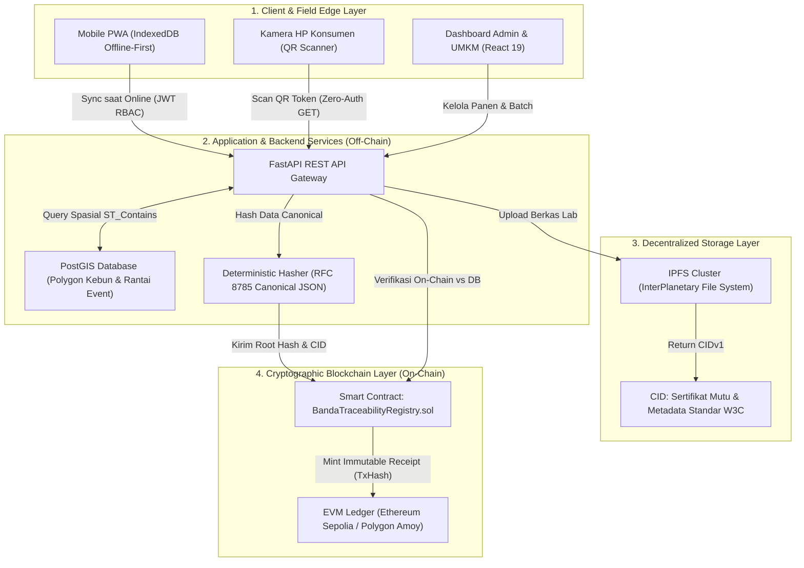
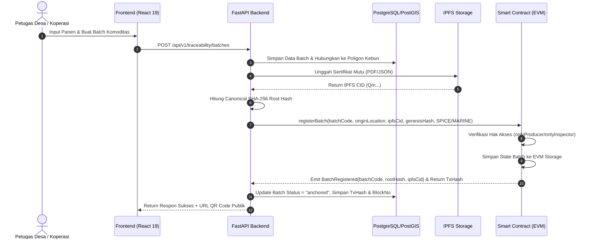
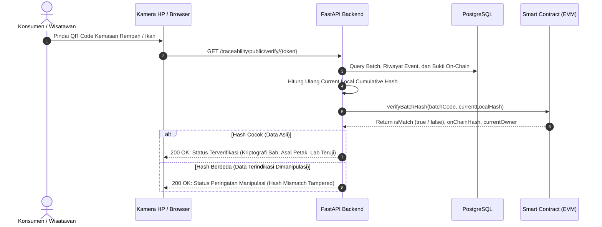
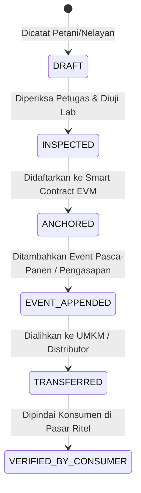

# DOKUMEN ARSITEKTUR KETERTELUSURAN (TRACEABILITY ARCHITECTURE)
## Sistem Hybrid Off-Chain PostGIS & On-Chain EVM Smart Contract
**Spesialis:** Khoirul Anam (*Blockchain & Traceability Specialist*)  
**Status:** Terverifikasi & Terintegrasi Penuh

---

## 1. Ikhtisar Arsitektur Sistem (Architectural Blueprint)

Sistem ketertelusuran Ekosistem Digital Banda Neira menggunakan pendekatan **Hybrid On-Chain/Off-Chain Architecture**. Pendekatan ini menyelesaikan masalah *blockchain trilemma* (skalabilitas, keamanan, dan desentralisasi) dengan memisahkan beban komputasi dan penyimpanan data berukuran besar (geospasial PostGIS dan sertifikat uji laboratorium) dari lapisan integritas kriptografi permanen (*EVM Immutable Ledger*).

---

## 2. Pemisahan Data On-Chain vs Off-Chain

Prinsip dasar arsitektur ini mematuhi **RULE 4 & RULE 5 AGENTS.md** (Zero-PII on blockchain & gas optimization):

| Karakteristik | Lapisan Off-Chain (PostgreSQL + PostGIS) | Lapisan Terdesentralisasi (IPFS) | Lapisan On-Chain (Smart Contract EVM) |
|---|---|---|---|
| **Data yang Disimpan** | - NIK, nama lengkap, kontak petani/nelayan - Poligon geospasial petak kebun (`geometry(Polygon, 4326)`) - Riwayat log panen internal desa - Antrean sinkronisasi offline | - Dokumen PDF sertifikat bebas aflatoksin/formalin - Foto resolusi tinggi penjemuran/pengasapan - Metadata JSON terstandarisasi (GS1 EPCIS / W3C Credential) | - ID Batch unik (`BN-BTC-2026-xxx`) - SHA-256 Event Root Hash (`0x...`) - IPFS Content Identifier (CID string) - Alamat dompet Ethereum pemilik batch saat ini - Jumlah peristiwa tercatat (`eventCount`) |
| **Karakteristik Keamanan** | Terenkripsi at-rest, terlindungi JWT auth dan Row-Level Security | Terdistribusi p2p, konten terindeks secara kriptografi (Content Addressed) | Imutabel (tidak dapat dimodifikasi), anti-sensor, publik |
| **Biaya Komputasi** | Biaya server standar | Biaya pin node IPFS lokal / Filecoin | Biaya gas transaksi EVM |
| **Kecepatan Akses** | < 10 ms (SQL query berindeks) | 200 - 600 ms (P2P gateway) | 1 - 2 detik (RPC view call) |

---

## 3. Pipa Deterministic Canonical JSON Hashing (RFC 8785)

Salah satu tantangan mendasar dalam menghubungkan basis data relasional dengan smart contract adalah sifat non-deterministik dari serialisasi JSON (urutan kunci kamus, spasi, representasi desimal floating point).

Sistem menerapkan **Canonical JSON Hashing** yang konsisten antara backend Python (`canonical_event_hasher.py`) dan smart contract:
1. **Pembersihan Data:** Menghilangkan seluruh field PII (NIK, nama petani, nomor telepon).
2. **Pengurutan Kunci Kamus (Lexicographical Key Sorting):** Seluruh kunci JSON diurutkan secara abjad (*alphabetical order*).
3. **Format Kompak Tanpa Whitespace:** Dihilangkan semua spasi setelah tanda koma dan titik dua (`separators=(',', ':')`).
4. **Hashing SHA-256:** Hasil string UTF-8 di-hash menggunakan algoritma SHA-256 menghasilkan 32-byte digest (`bytes32`).

### Formula Hashing Event:
$$H_0 = \text{SHA-256}(\text{Canonicalize}(\text{GenesisEvent}))$$
$$H_n = \text{SHA-256}(H_{n-1} \,\|\, \text{Canonicalize}(\text{Event}_n))$$

Di mana:
- $H_n$ adalah hash kumulatif pada event ke-$n$.
- $\|$ melambangkan operasi konkatenasi byte.
- Jika ada satu karakter atau nilai dalam riwayat diubah, maka $H_n$ akhir akan berbeda drastis (*avalanche effect*), menyebabkan smart contract menolak status validitasnya.

---

## 4. Diagram Alur Transaksi & Verifikasi (Sequence Diagrams)

### 4.1. Alur Pendaftaran & Anchoring Batch ke Blockchain

---

### 4.2. Alur Pemindaian QR Publik oleh Konsumen (Zero-Authentication)

---

## 5. Mesin State Siklus Hidup Batch (Batch Lifecycle State Machine)

Setiap batch komoditas berpindah melalui state berikut:

1. **`DRAFT`:** Data batch baru dibuat oleh petani/nelayan. Status lokal di database, belum memiliki nomor transaksi blockchain.
2. **`INSPECTED`:** Petugas desa memvalidasi keaslian lokasi kebun/tangkapan dan mengunggah hasil uji laboratorium.
3. **`ANCHORED`:** Batch resmi tercatat di blockchain melalui transaksi `registerBatch`. Memiliki TxHash dan Block Number unik.
4. **`EVENT_APPENDED`:** Peristiwa tambahan (pengeringan, sortasi, pengasapan Ikan Asar) diikatkan ke rantai event dengan hash kumulatif baru.
5. **`TRANSFERRED`:** Kepemilikan fisik dan hak pengedaran dialihkan dari petani/nelayan ke unit UMKM atau koperasi melalui fungsi `transferBatchOwnership`.
6. **`VERIFIED`:** Status operasional saat konsumen memverifikasi QR code produk dan menerima sertifikat keaslian interaktif.

---

## 6. Penanganan Kegagalan & Ketahanan Jaringan (Resilience & Fallback)

1. **Konektivitas Node RPC Terputus:** Backend dilengkapi mekanisme *circuit breaker* dengan fallback otomatis dari node lokal ke gateway publik (Sepolia Infura / Alchemy / Polygon Amoy Public RPC).
2. **Kondisi Offline Total (Banda Blackout):** Transaksi tetap di-hash secara lokal di SQLite/IndexedDB edge. Ketika internet satelit/4G kembali menyala, worker sinkronisasi mengeksekusi *batch anchoring* secara asinkron tanpa kehilangan urutan kronologis.
3. **Integritas Waktu (Timestamp Drift):** Timestamp event dicatat menggunakan UTC standar ISO-8601 di sisi backend dan dicocokkan dengan `block.timestamp` pada blockchain untuk mencegah pemalsuan kronologi.

---

*Disahkan oleh Khoirul Anam - Arsitektur Traceability Ekosistem Digital Banda Neira.*
