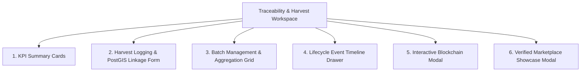

# DOKUMEN DASHBOARD MONITORING KETERTELUSURAN
## Desain Antarmuka dan Alur Kerja Monitoring Traceability Banda Neira
**Spesialis:** Khoirul Anam (*Blockchain & Traceability Specialist*)  
**Implementasi UI/UX:** Neo-Obsidian Cyber-Emerald Design System (React 19 + TypeScript)

---

## 1. Filosofi Desain & Kebutuhan Lapangan

Dashboard monitoring ketertelusuran dirancang untuk menjawab tantangan operasional di Kepulauan Banda:
1. **Keterbacaan Lapangan di Bawah Sinar Matahari (High Contrast & Ambient Awareness):** Palet warna *Neo-Obsidian Cyber-Emerald* dengan latar belakang gelap pekat (`#020617`), aksen emerald neon (`#10b981`), dan cyan bahari (`#06b6d4`) memberikan keterbacaan tajam baik di ruangan kantor desa maupun di para-para penjemuran atau dermaga pendaratan ikan.
2. **Operasional Satu Tangan pada Layar Ponsel (Mobile Ergonomics):** Tombol aksi utama, pemindai QR, dan filter kategori diletakkan pada zona jangkauan ibu jari (*thumb zone*).
3. **Penyajian Status Kriptografi yang Ramah Awam (Explainable Blockchain UX):** Mengubah data teknis rumit (hexadecimal hash, gas unit, block height) menjadi indikator visual intuitif: pita hijau terverifikasi, ikon rantai emas, dan lencana keaslian Indikasi Geografis.

---

## 2. Struktur Komponen Dashboard

### 2.1. KPI Summary Cards (Metrik Agregat)
- **Total Panen & Tangkapan:** Akumulasi bobot komoditas (kg) yang tercatat dalam periode aktif.
- **Jumlah Batch Aktif:** Total batch yang sedang dalam proses pengolahan, pengeringan, atau pengasapan.
- **Batch Anchored (On-Chain):** Jumlah batch yang telah diikatkan secara permanen ke smart contract EVM.
- **Rasio Mutu Super / Grade A (%):** Persentase panen yang memenuhi standar ekspor (kadar air <10% untuk pala, organoleptik prima untuk ikan).

---

### 2.2. Form Pencatatan Panen Terintegrasi PostGIS
Formulir input dirancang adaptif berdasarkan peran pengguna:
- **Pilihan Komoditas:** Pilihan cepat antara Pala Banda, Fuli Merah, Cengkeh, Ikan Cakalang, dan Tuna Sirip Kuning.
- **Penautan Petak Spasial:** Untuk komoditas darat, sistem memuat daftar petak kebun terverifikasi milik petani yang diambil dari layer PostGIS. Hal ini memastikan panen tidak dapat dicatat di luar batas kepemilikan sah.
- **Validasi Mutu Dinamis:** Bidang kadar air (%) otomatis muncul untuk pala/fuli, sedangkan bidang metode penanganan rantai dingin (suhu palka es) muncul untuk komoditas laut.

---

### 2.3. Batch Management Grid & Generator QR
Menampilkan kartu-kartu batch komoditas dengan rincian:
- **Identitas Batch:** Kode batch unik (`BN-BTC-2026-001`), tanggal genesis, dan desa asal.
- **Status Badge:** `draft` (abu-abu), `anchored` (biru cyan), `verified` (hijau emerald).
- **Pratinjau QR Code Kemasan:** Thumbnail QR code yang otomatis ter-generate dari endpoint backend. Tombol *Download Label* memungkinkan operator mencetak stiker QR untuk ditempel pada karung goni atau kemasan vakum.
- **Tombol Aksi Cepat:**
  - `+ Tambah Event`: Membuka modal input event pengeringan/pengasapan/lab test.
  - `⛓️ Anchor ke Blockchain`: Memicu transaksi smart contract.
  - `🔍 Audit Kriptografi`: Membuka `BlockchainModal` untuk audit real-time.

---

### 2.4. Interactive Blockchain Modal (`BlockchainModal.tsx`)
Komponen modal pop-up yang menampilkan transparansi on-chain secara mendalam:
1. **Lencana Status Kriptografi:**
   - Hijau: `KRIPTOGRAFI SAH & SESUAI` (Hash lokal identik dengan on-chain hash).
   - Merah: `PERINGATAN MANIPULASI DATA` (Hash mismatch terdeteksi).
2. **Metadata Transaksi EVM:**
   - Jaringan: Ethereum Sepolia / Polygon Amoy.
   - Smart Contract Address (dengan tombol salin).
   - Transaction Hash (TxHash) lengkap dengan tautan langsung ke Block Explorer.
   - Block Number & Gas Terpakai.
3. **Perbandingan Hash:** Memperlihatkan secara berdampingan string 32-byte hash lokal dengan hash yang tersimpan di storage smart contract.
4. **Alamat Pemilik Terkini (Current Custody):** Menampilkan dompet petani, kelompok tani, atau UMKM yang memegang hak edar.

---

### 2.5. Verified Marketplace Showcase (`VerifiedMarketplaceModal.tsx`)
Etalase terdesentralisasi yang menampilkan 5 produk unggulan Banda:
1. **Pala Banda Grade A Super** (Desa Lonthoir) - Rp 75.000 / 250g
2. **Fuli Merah Murni Banda** (Desa Lonthoir Tengah) - Rp 95.000 / 100g
3. **Ikan Asar Cakalang Tradisional** (Nusantara / Lonthoir) - Rp 45.000 / ekor
4. **Tuna Sirip Kuning Segar Sashimi** (Perairan Laut Banda) - Rp 120.000 / kg
5. **Sirup Buah Pala Murni Banda** (UMKM Dender) - Rp 35.000 / botol 350ml

Setiap produk dilengkapi tombol **"Cek Bukti Asal-Usul (On-Chain)"** yang langsung membuka jendela `PublicVerifyModal` untuk memverifikasi riwayat kebun/laut komoditas tersebut.

---

## 3. Integrasi PWA & Ketahanan Jaringan di Wilayah Blankspot

Ketika petugas berada di kebun lereng Gunung Api Banda yang tidak terjangkau sinyal:
1. Data panen baru disimpan ke **IndexedDB** lokal melalui modul `syncManager.ts`.
2. Lencana status di bagian atas navbar (`HeaderNav.tsx`) otomatis berubah warna menjadi kuning: *Mode Offline Aktif - X Perubahan Tersimpan Lokal*.
3. Saat petugas kembali ke area sinyal di balai desa, antrean otomatis disinkronkan ke server FastAPI tanpa memerlukan intervensi manual.

---

*Disetujui untuk panduan teknis antarmuka - Khoirul Anam.*
