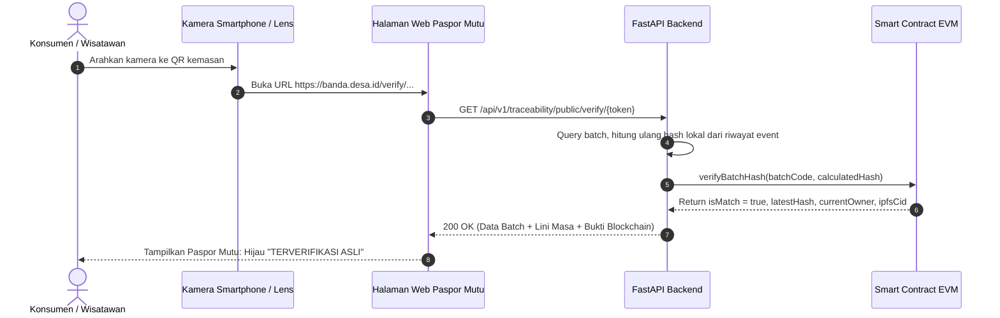

# DOKUMEN FITUR VERIFIKASI QR CODE DAN KODE BATCH
## Mekanisme Verifikasi Publik Paspor Mutu Komoditas Tanpa Otentikasi
**Spesialis:** Khoirul Anam (*Blockchain & Traceability Specialist*)  
**Format Token:** Canonical Alphanumeric (`BN_VERIFY_<COMMODITY>_<YEAR>_<ORIGIN>`)  
**Tingkat Koreksi Kesalahan QR:** ISO/IEC 18004 Error Correction Level M (15%)

---

## 1. Konsep & Tujuan Fitur Verifikasi Publik

Fitur verifikasi QR code dirancang untuk memberikan transparansi penuh kepada konsumen akhir, wisatawan kuliner, dan pembeli ekspor tanpa memerlukan instalasi aplikasi khusus atau akun login desa (**Zero-Authentication Principle**).

Dengan memindai kode QR yang tertera pada kemasan biji pala, botol sirup pala, atau kemasan vakum Ikan Asar, konsumen dapat langsung memverifikasi keaslian Indikasi Geografis Banda dan memeriksa apakah produk tersebut benar-benar berasal dari perkebunan/perairan Banda Neira atau merupakan produk tiruan dari luar pulau.

---

## 2. Struktur Token & URL Pemindaian

Setiap batch memiliki sepasang pengidentifikasi:
1. **`batch_code`:** Kode operasional internal desa, format: `BN-BTC-2026-XXX`.
2. **`verification_token`:** Token kriptografis aman URL, format:
   ```text
   BN_VERIFY_[COMMODITY]_[YEAR]_[LOCATION_SLUG]
   Contoh 1 (Pala):      BN_VERIFY_PALA_SUPER_2026_LONTHOIR
   Contoh 2 (Fuli):      BN_VERIFY_FULI_MERAH_2026_BELGICA
   Contoh 3 (Ikan Asar): BN_VERIFY_IKAN_ASAR_2026_NUSANTARA
   Contoh 4 (Tuna):      BN_VERIFY_TUNA_SASHIMI_2026_BANDA_SEA
   ```

### Struktur URL Resolusi
Konsumen yang memindai QR code akan diarahkan ke URL resolusi resmi:
```text
https://banda.desa.id/verify/BN_VERIFY_PALA_SUPER_2026_LONTHOIR
```
Pada lingkungan pengembangan lokal atau LAN pengujian:
```text
http://192.168.8.89:5175/?verify=BN_VERIFY_PALA_SUPER_2026_LONTHOIR
```

Frontend secara otomatis menangkap parameter query `?verify=<token>` atau path `/verify/<token>` pada saat pemuatan awal dan membuka modal verifikasi interaktif (`PublicVerifyModal.tsx`) secara instan.

---

## 3. Alur Pengalaman Konsumen (Consumer Journey)



---

## 4. Informasi yang Disajikan pada Halaman Paspor Mutu

Antarmuka verifikasi publik (`PublicVerifyModal.tsx`) menyajikan empat seksi informasi transparan:

### Seksi 1: Lencana Keaslian & Sertifikasi
- **Lencana Hijau Terverifikasi:** Menandakan batch memiliki bukti sah di smart contract dan hash data tidak pernah dimodifikasi.
- **Sertifikasi Indikasi Geografis (IG):** Menampilkan nomor sertifikat resmi IG "Pala Banda" atau sertifikat higienitas Dinas Kelautan.
- **Nama Komoditas & Grade Mutu:** Misal: *Pala Banda Grade A Super (Kadar Air 9.2%)*.

### Seksi 2: Informasi Asal-Usul (Zero-PII Compliance)
- **Nama Kelompok Tani / KUB Nelayan:** Menampilkan nama lembaga tani (misal: *Poktan Lonthoir Subur*), tanpa mengekspos NIK, nomor KTP, atau nomor telepon pribadi petani.
- **Desa & Pulau Asal:** Menampilkan desa administratif (Desa Lonthoir, Pulau Banda Besar).
- **Metode Budidaya / Penangkapan:** Organik lereng vulkanik / Pancing ulur ramah lingkungan.

### Seksi 3: Lini Masa Rantai Pasok (Chronological Audit Trail)
Setiap tahapan ditampilkan dalam kartu vertikal berurut:
1. **Registrasi Panen / Pendaratan Ikan:** Tanggal, bobot awal, dan koordinat umum desa.
2. **Pascapanen / Pengolahan:** Log penjemuran matahari (kadar air <10%) atau pengasapan tempurung kenari 5 jam.
3. **Uji Laboratorium Mutu:** Uji aflatoksin negatif / bebas formalin dengan tautan unduh sertifikat PDF dari IPFS.
4. **Pengemasan & Penyegelan QR:** Tanggal batch disegel siap edar.

### Seksi 4: Bukti Kriptografi On-Chain
- Jaringan Blockchain: Ethereum Sepolia / Polygon Amoy.
- Alamat Kontrak Cerdas: `0x5FbDB2315678afecb367f032d93F642f64180aa3`.
- Nomor Blok & Transaction Hash (dapat diklik langsung menuju block explorer publik).
- Hash Data On-Chain vs Hash Terhitung Lokal (keduanya identik).

---

## 5. Penanganan Kasus Token Palsu & Peringatan Manipulasi

Sistem menangani skenario anomali dengan memberikan pesan visual yang jelas:

1. **Token Tidak Terdaftar / Tidak Dikenali (`HTTP 404 Not Found`):**
   - Layar menampilkan lencana merah: `⚠️ KODE TOKEN TIDAK TERDAFTAR`.
   - Pesan: *"Nomor batch atau token QR yang Anda masukkan tidak terdaftar dalam basis data resmi Ekosistem Digital Banda Neira. Waspadai produk tiruan atau kemasan yang tidak resmi."*
2. **Hash On-Chain Tidak Cocok (Terindikasi Dimanipulasi):**
   - Layar menampilkan peringatan bahaya: `🚨 PERINGATAN INTEGRITAS: DATA DIMANIPULASI`.
   - Menjelaskan bahwa riwayat peristiwa di basis data lokal telah diubah oleh pihak yang tidak bertanggung jawab dan tidak sesuai dengan bukti segel smart contract permanen.

---

*Disetujui untuk panduan teknis verifikasi publik - Khoirul Anam.*
