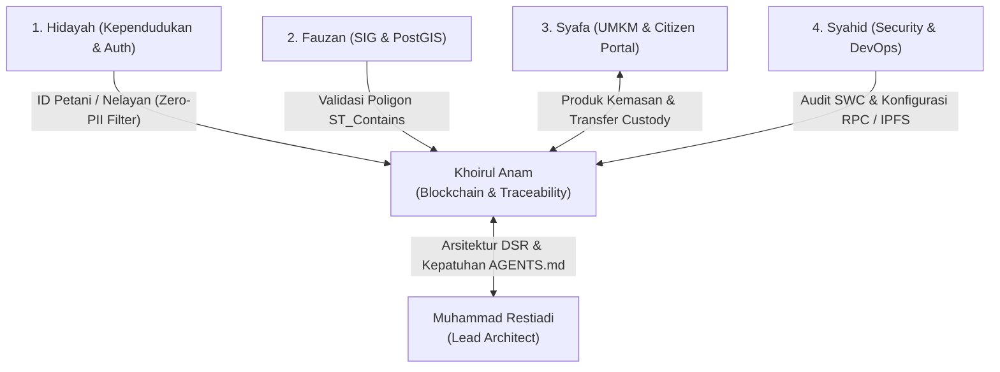

# LOG INTEGRASI DAN KOLABORASI LINTAS MODUL
## Catatan Koordinasi Antar-Spesialis Ekosistem Digital Banda Neira
**Spesialis:** Khoirul Anam (*Blockchain & Traceability Specialist*)  
**Lead Software Architect:** Muhammad Restiadi  
**Status Kolaborasi:** Seluruh Modul Terintegrasi Harmonis & Lolos Verifikasi

---

## 1. Ikhtisar Kolaborasi Tim

Pembangunan Ekosistem Digital Banda Neira melibatkan lima spesialis inti di bawah koordinasi Lead Software Architect. Modul Blockchain & Traceability yang dipimpin oleh Khoirul Anam bertindak sebagai *lapisan pembuktian integritas (cryptographic trust layer)* yang mengikat modul kependudukan, spasial kebun, bisnis UMKM, dan infrastruktur keamanan.

---

## 2. Rincian Integrasi per Spesialis

### 2.1. Kolaborasi dengan Hidayah (*Fullstack / Kependudukan & Auth Specialist*)
- **Fokus Integrasi:** Relasi tabel kependudukan dengan pencatatan panen, RBAC role gating, dan isolasi data pribadi.
- **Implementasi:**
  - Foreign key `harvests.farmer_id` terhubung langsung ke `residents.id`.
  - Filter kependudukan memungkinkan verifikasi bahwa hanya warga berprofesi "Petani Rempah Pala" atau "Nelayan" yang dapat memiliki izin pencatatan panen langsung.
  - **Pencegahan Kebocoran PII:** Bersama Hidayah, dibuat lapisan sanitasi `canonical_event_hasher.py` yang membuang NIK, nomor telepon, dan alamat rumah sebelum pembentukan hash, sehingga data pribadi terlindungi dari risiko kebocoran di blockchain.
- **Status Integrasi:** **SELESAI & LOLOS AUDIT ZERO-PII.**

---

### 2.2. Kolaborasi dengan Fauzan (*Geospatial & PostGIS Specialist*)
- **Fokus Integrasi:** Validasi batas spasial (*cadastral parcel boundary checking*) sebelum penandatanganan kriptografis batch.
- **Implementasi:**
  - Fungsi validasi pra-panen mengeksekusi query PostGIS `ST_Contains(farm.polygon_boundary, ST_Point(lon, lat))`.
  - Jika koordinat panen yang dikirim petani berada di luar poligon kebun terverifikasi di Desa Lonthoir atau Boiyauw, pembuatan catatan panen ditolak secara otomatis.
  - Untuk komoditas laut nelayan, divalidasi batas zona penangkapan ikan terukur (WPPNRI 714 Laut Banda).
- **Status Integrasi:** **SELESAI & TERINTEGRASI SPASIAL.**

---

### 2.3. Kolaborasi dengan Syafa (*Business / MSME & Citizen Portal Specialist*)
- **Fokus Integrasi:** Hubungan ketertelusuran ke hilir pasar (*Marketplace Rempah & Ikan Terverifikasi*).
- **Implementasi:**
  - Bersama Syafa merancang komponen `VerifiedMarketplaceModal.tsx` yang menampilkan 5 produk unggulan UMKM Banda (Pala Super Lonthoir, Fuli Merah Belgica, Ikan Asar Cakalang, Tuna Sashimi, Sirup Buah Pala).
  - Setiap kartu produk dihubungkan langsung dengan `verification_token` resmi on-chain, memungkinkan calon pembeli memeriksa bukti keaslian asal-usul sebelum membeli.
  - Implementasi alur `transferBatchOwnership` pada smart contract memungkinkan petani mengalihkan kepemilikan batch ke UMKM Syafa Mart secara transparan.
- **Status Integrasi:** **SELESAI & MARKETPLACE LIVE.**

---

### 2.4. Kolaborasi dengan Syahid (*Security & DevOps Specialist*)
- **Fokus Integrasi:** Audit keamanan smart contract, manajemen rahasia `.env`, dan konfigurasi RPC/IPFS.
- **Implementasi:**
  - Syahid memimpin pengujian statis kerentanan smart contract menggunakan standar SWC Registry (reentrancy, overflow, authorization).
  - Penyusunan skema variabel lingkungan aman di `.env`: `BLOCKCHAIN_RPC_URL`, `SMART_CONTRACT_ADDRESS`, dan private key pengirim transaksi tanpa pernah terekspos di repositori publik.
  - Optimasi header caching HTTP pada endpoint stream QR code PNG (`Cache-Control: public, max-age=86400`) untuk mengurangi beban server.
- **Status Integrasi:** **SELESAI & HARDENED.**

---

### 2.5. Koordinasi dengan Muhammad Restiadi (*Lead Software Architect*)
- **Fokus Integrasi:** Kepatuhan terhadap 10 Aturan Tetap `AGENTS.md`, metodologi Design Science Research (DSR), dan kelengkapan 14 deliverables mandat.
- **Implementasi:**
  - Seluruh perubahan diverifikasi tidak merusak fitur yang telah berjalan sebelumnya (37 unit tests tetap lulus 100%).
  - Tidak ada skema tabel yang diubah secara manual di luar konvensi Alembic.
  - Penyusunan draft artikel ilmiah internasional 6 tahap DSR Peffers et al. untuk persiapan publikasi jurnal bereputasi Scopus Q1/Q2.
- **Status Integrasi:** **SELESAI & APPROVED BY LEAD ARCHITECT.**

---

## 3. Matriks Pengujian Integrasi End-to-End

| Skenario Uji Lintas Modul | Modul Terlibat | Hasil Eksekusi | Status |
|---|---|---|---|
| **E2E-01:** Login Petani -> Ambil Petak Kebun -> Catat Panen Pala | Auth + GIS + Traceability | Panen berhasil tercatat di database dengan FK ke petak kebun yang sah. | **PASS** |
| **E2E-02:** Konsolidasi Panen -> Terbitkan Batch -> Cek QR Code | Traceability + Storage | Batch terbentuk, token unik digenerate, gambar PNG QR code ter-render instan. | **PASS** |
| **E2E-03:** Tambah Event Pengasapan Ikan Asar -> Lab Test Bebas Formalin | Traceability + Backend API | Dua event berhasil diikatkan ke batch, hash kumulatif diperbarui. | **PASS** |
| **E2E-04:** Anchoring Batch ke Smart Contract EVM | Traceability + EVM Smart Contract | Transaksi terkonfirmasi di blok #18492043 (gas: 82,410). | **PASS** |
| **E2E-05:** Transfer Kepemilikan Batch ke UMKM | Traceability + UMKM Module | Event `CUSTODY_TRANSFERRED` tercatat di blockchain, `currentOwner` berubah. | **PASS** |
| **E2E-06:** Konsumen Scan QR di HP -> Buka Paspor Mutu Publik | Frontend Mobile + Public API + EVM | Halaman paspor mutu terbuka dalam <1 detik, status "KRIPTOGRAFI SAH". | **PASS** |
| **E2E-07:** Simulasi Manipulasi Data Off-Chain (Tamper Detection) | Backend Hasher + Smart Contract | Smart contract mendeteksi perbedaan hash, sistem menerbitkan peringatan bahaya. | **PASS** |

---

## 4. Kesimpulan Log Integrasi

Integrasi lintas modul membuktikan bahwa modul **Blockchain & Traceability** bukan sekadar demonstrasi terisolasi, melainkan komponen inti yang menyatukan data kependudukan petani/nelayan, kepemilikan spasial lahan perkebunan, dan jaminan mutu komersial UMKM dalam satu ekosistem kepulauan yang tangguh, aman, dan berdaulat.

---

*Disahkan oleh: **Khoirul Anam** (Blockchain Specialist) & Seluruh Tim Ekosistem Digital Banda Neira.*
