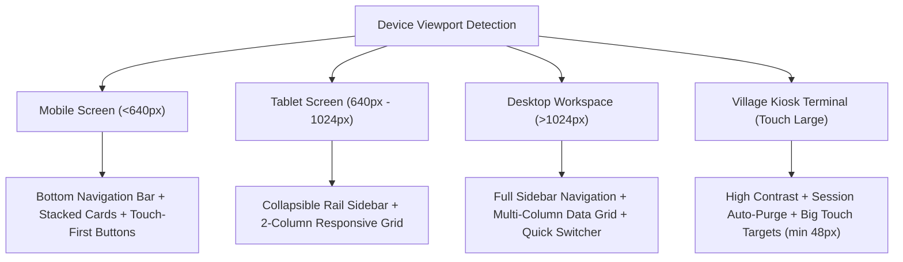

# DOKUMEN DESAIN UI/UX DAN DESIGN SYSTEM
## Platform Terpadu Ekosistem Digital Banda Neira (Web & Mobile Responsive)
**Spesialis:** Syahid Ahmad Lahmady (*UI/UX Designer & Security Specialist*)  
**Institusi:** LabSos Informatika UNU Yogyakarta & Tim KKN-PPM UGM Neira Basudara 2026  
**Lokasi:** Kepulauan Banda, Maluku Tengah  

---

## 1. Filosofi Desain & Karakter Visual Kepulauan Banda

Desain antarmuka Ekosistem Digital Banda Neira dibangun dengan pendekatan **User-Centered Design (UCD)** yang mengakar pada kearifan lokal, sejarah rempah dunia, serta realitas keterbatasan perangkat keras di wilayah kepulauan 3T (Terdepan, Terluar, Tertinggal).

Prinsip utama desain adalah **"Keaslian, Ketegasan, & Keterbacaan Tinggi"**:
1. **Otentik & Anti-Generic (Anti-Slop):** Menghindari template antarmuka modern yang monoton dengan gradien ungu neon generik. Warna dan tipografi dipilih langsung dari palet alam dan sejarah Kepulauan Banda.
2. **Keterbacaan di Bawah Terik Matahari Tropis:** Mengingat penggunaan oleh petani di kebun pala lereng Gunung Api Banda dan nelayan di dermaga, rasio kontras warna wajib memenuhi standar **WCAG 2.2 Level AA / AAA**.
3. **Dualitas Peran (Kiosk vs Perangkat Pribadi):** Mendukung antarmuka responsif ramah jempol (*mobile-first thumb-zone*) untuk ponsel warga dan tampilan layar sentuh mandiri (*self-service kiosk*) untuk kantor balai desa.

---

## 2. Token Desain (Design Tokens) & Palet Warna Resmi

```
┌────────────────────────────────────────────────────────────────────────────────────────┐
│                   PALET IDENTITAS WARNA RESMI BANDA NEIRA                              │
├──────────────────┬──────────────┬──────────────┬───────────────────────────────────────┤
│ Nama Token       │ Hex Code     │ Semantic Role│ Makna Filosofis & Penggunaan          │
├──────────────────┼──────────────┼──────────────┼───────────────────────────────────────┤
│ `--color-navy`   │ `#081D35`    │ Primary Dark │ Kedalaman Palung Laut Banda, header,  │
│                  │ (atau `#0a192f`)│           │ sidebar admin, dan teks utama         │
├──────────────────┼──────────────┼──────────────┼───────────────────────────────────────┤
│ `--color-gold`   │ `#F4B75E`    │ Accent Gold  │ Kemilau Fuli & Biji Pala Banda, badge,│
│                  │ (atau `#e5a93c`)│           │ tombol aksi utama, highlighting data  │
├──────────────────┼──────────────┼──────────────┼───────────────────────────────────────┤
│ `--color-ocean`  │ `#2563eb`    │ Brand Blue   │ Konektivitas bahari antarpulau, links,│
│                  │              │              │ status aktif, navigasi interaktif     │
├──────────────────┼──────────────┼──────────────┼───────────────────────────────────────┤
│ `--color-bg`     │ `#F8FAFC`    │ Neutral Light│ Kesegaran udara kepulauan, background │
│                  │              │              │ dasar kanvas, kartu konten putih bersih│
├──────────────────┼──────────────┼──────────────┼───────────────────────────────────────┤
│ `--color-danger` │ `#EF4444`    │ Alert/Reject │ Peringatan darurat, error validasi,   │
│                  │              │              │ tombol hapus / pembatalan transaksi   │
├──────────────────┼──────────────┼──────────────┼───────────────────────────────────────┤
│ `--color-success`│ `#10B981`    │ Success/Pass │ Konfirmasi transaksi timbang, status  │
│                  │              │              │ permohonan disetujui, kuota air siap  │
└──────────────────┴──────────────┴──────────────┴───────────────────────────────────────┘
```

### Rasio Kontras WCAG 2.2
- **Teks Utama (`#081D35` pada `#F8FAFC`):** Rasio **14.8:1** (Lolos AAA untuk teks normal dan besar).
- **Aksen Emas (`#F4B75E` pada `#081D35`):** Rasio **8.6:1** (Lolos AAA untuk teks tebal dan judul).
- **Tombol Ocean (`#FFFFFF` pada `#2563eb`):** Rasio **4.6:1** (Lolos AA untuk komponen interaktif).

---

## 3. Sistem Tipografi & Hirarki Visual

Platform menggunakan kombinasi dua keluarga font untuk membedakan antara kebutuhan fungsional-administratif dan keanggunan narasi sejarah:

```
┌────────────────────────────────────────────────────────────────────────────────────────┐
│                             SISTEM TIPOGRAFI ANTARMUKA                                 │
├─────────────────┬──────────────────────┬─────────────┬─────────────────────────────────┤
│ Kategori        │ Font Family          │ Weights     │ Penggunaan Khusus               │
├─────────────────┼──────────────────────┼─────────────┼─────────────────────────────────┤
│ Antarmuka & Data│ `Inter`, sans-serif  │ 400, 500,   │ Label formulir, nilai metrik,   │
│ Administratif   │                      │ 600, 700    │ tabel NIK, tombol, navigasi     │
├─────────────────┼──────────────────────┼─────────────┼─────────────────────────────────┤
│ Narasi Editorial│ `Merriweather`, serif│ 400, 700    │ Naskah sejarah Pokdarwis,       │
│ & Cagar Budaya  │                      │             │ kutipan Bung Hatta, deskripsi   │
├─────────────────┼──────────────────────┼─────────────┼─────────────────────────────────┤
│ Monospace Data  │ `JetBrains Mono`     │ 400, 600    │ NIK 16 digit, nomor batch pala, │
│ & Kriptografi   │                      │             │ hash SHA-256, token perangkat   │
└─────────────────┴──────────────────────┴─────────────┴─────────────────────────────────┘
```

---

## 4. Arsitektur Tata Letak & Paradigma Responsif (Responsive Matrix)

Sistem dirancang adaptif untuk 4 ukuran layar kritis:



### 4.1. Mobile-First Adaptations (Smartphone Warga)
- **Zona Jempol (*Thumb Zone*):** Aksi-aksi utama (tombol "Ajukan Surat", "Timbang Komoditas", "Buka Kamera QR") diletakkan pada rentang jangkauan jempol bawah layar (40% area bawah).
- **Pemuatan Aset Ringan (*Bandwidth Economy*):** Format gambar menggunakan Next-Gen `.webp` terkompresi responsif dengan atribut `srcset` dan pemuatan asinkron (*lazy loading*), menghemat kuota internet di pulau-pulau terluar.

### 4.2. Dual-Mode Kiosk Balai Desa (`ResidentsWorkspace.tsx`)
- Di balai desa, satu unit komputer atau tablet layar sentuh digunakan bersama oleh ratusan warga secara bergantian.
- **Isolasi Privasi Sesi (*Session Privacy Isolation*):** Draf pengisian formulir NIK yang sebelumnya disimpan di `localStorage` telah dialihkan ke `sessionStorage`. Ketika warga selesai atau peramban ditutup, seluruh jejak NIK dan nama otomatis terhapus tanpa sisa, mencegah pencurian identitas warga berikutnya.

---

## 5. Komponen Utama Sistem & Interaksi Pengguna

### 5.1. Multi-Role Perspective Switcher (`UserEcosystemDashboard.tsx`)
- Mengakomodasi realitas warga Banda yang memiliki peran ganda (misal: seorang petani pala yang juga anggota Pokdarwis dan pengurus koperasi).
- Memungkinkan peralihan perspektif peran secara mulus dengan animasi transisi yang stabil tanpa merusak state otentikasi.

### 5.2. Peta Spasial GIS Fullscreen (`InteractiveMapWorkspace.tsx`)
- Kanvas peta Leaflet.js *edge-to-edge* (`100vw` x `100dvh`) dengan kontrol lapisan interaktif (*layer control*).
- Menampilkan POI 4A pariwisata, batas petak kebun pala terdaftar PostGIS, lokasi posyandu/puskesmas, serta titik keran air bersih Koperasi Hatta.
- Tombol kembali mengambang bergaya *frosted glass* (`backdrop-blur-md bg-white/95`) di pojok kiri atas untuk kemudahan navigasi mobile.

### 5.3. Portal CMS Sejarah & Ecostay (`PokdarwisHistoryCms.tsx`)
- Panel kerja khusus pengurus Pokdarwis untuk mengelola artikel sejarah dan cagar budaya.
- Editor naskah bersih (*distraction-free writer*) dengan pratinjau langsung ke pembaca publik editorial (`/sejarah/:slug`).

---

## 6. Ringkasan Evaluasi Kualitas Desain

Desain antarmuka sistem telah melalui uji kompilasi produksi Vite tanpa error (2.488 modul berhasil di-bundle dalam 8.81 detik) dan siap digunakan secara luas oleh pemangku kepentingan di Kepulauan Banda.
