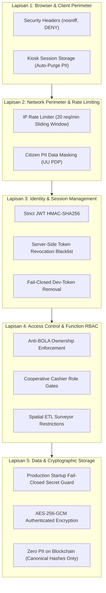

# DOKUMEN THREAT MODEL DAN RANCANGAN KEAMANAN
## Arsitektur Pertahanan Berlapis (Defense in Depth) & Model Ancaman STRIDE
**Spesialis:** Syahid Ahmad Lahmady (*UI/UX Designer & Security Specialist*)  
**Framework:** STRIDE Threat Modeling, OWASP Top 10 Web (2021), OWASP API Security Top 10 (2023)  

---

## 1. Identifikasi Aset Kritis Sistem (Critical Assets Inventory)

Dalam ekosistem digital Kepulauan Banda, aset informasi diklasifikasikan ke dalam 4 kategori berdasarkan sensitivitas dan nilai bisnis:

```
┌────────────────────────────────────────────────────────────────────────────────────────┐
│                        INVENTARIS ASET KRITIS SISTEM                                   │
├────┬─────────────────────────────┬─────────────────┬──────────────────────────────────┤
│ ID │ Nama Aset                   │ Klasifikasi     │ Dampak Jika Terkompromi          │
├────┼─────────────────────────────┼─────────────────┼──────────────────────────────────┤
│ A1 │ Data Kependudukan (NIK, KK, │ RAHASIA         │ Pelanggaran UU PDP No. 27/2022,  │
│    │ Nama, Alamat, Nomor Kontak) │ (PII / Private) │ doxing warga, penipuan finansial │
├────┼─────────────────────────────┼─────────────────┼──────────────────────────────────┤
│ A2 │ Saldo Finansial Koperasi &  │ SANGAT TINGGI   │ Kerugian moneter kas desa,       │
│    │ Kuota Air Minum Solenoid    │ (Financial)     │ perebutan kuota air saat kemarau │
├────┼─────────────────────────────┼─────────────────┼──────────────────────────────────┤
│ A3 │ Kunci Privat, Secret Keys,  │ KRITIS          │ Kompromi total seluruh server,   │
│    │ & Token JWT Otentikasi      │ (Credentials)   │ bypass hak akses administrator   │
├────┼─────────────────────────────┼─────────────────┼──────────────────────────────────┤
│ A4 │ Sensor IoT Cuaca & Keran    │ OPERASIONAL     │ Sabotase pasokan air bersih,     │
│    │ Otomatis ESP32 Solenoid     │ (Physical IoT)  │ data telemetri palsu di laut     │
└────┴─────────────────────────────┴─────────────────┴──────────────────────────────────┘
```

---

## 2. Pemetaan Model Ancaman STRIDE

Analisis ancaman dilakukan secara sistematis menggunakan kerangka kerja **STRIDE**:

```
┌────────────────────────────────────────────────────────────────────────────────────────┐
│                         MATRIKS ANCAMAN MODEL STRIDE                                   │
├─────────────┬─────────────────────────────────┬────────────────────────────────────────┤
│ Kategori    │ Deskripsi Potensi Serangan      │ Kontrol Mitigasi Keamanan              │
├─────────────┼─────────────────────────────────┼────────────────────────────────────────┤
│ **S**poofing│ Penyerang memalsukan identitas  │ Otentikasi JWT terverifikasi, larangan │
│             │ warga dengan header offline-jwt │ offline-dev token, dan Pre-Shared Key  │
│             │ atau sensor ESP32 palsu.        │ (PSK) pada ingest telemetri IoT.       │
├─────────────┼─────────────────────────────────┼────────────────────────────────────────┤
│ **T**ampering| Memanipulasi permohonan surat   │ Validasi integritas Pydantic, hash     │
│             │ warga lain (BOLA) atau saldo air│ SHA-256 deterministik, dan enkripsi    │
│             │ koperasi di basis data.         │ AES-256-GCM data sensitif.             │
├─────────────┼─────────────────────────────────┼────────────────────────────────────────┤
│ **R**epudiation| Kasir atau warga menyangkal   │ Logging audit trail komprehensif, penca│
│             │ transaksi penimbangan komoditas.│ tatan NIK operator, & anchor on-chain. │
├─────────────┼─────────────────────────────────┼────────────────────────────────────────┤
│ **I**nformation| Pemanenan massal NIK warga via │ Rate limiter per-IP (20 req/menit),    │
│  Disclosure │ endpoint publik /identify-account| masking nama warga, isolasi session.  │
├─────────────┼─────────────────────────────────┼────────────────────────────────────────┤
│ **D**enial  │ Membanjiri API backend dengan   │ Rate limiting, proteksi memori, batas  │
│  of Service │ jutaan request hingga server down| payload JSON, dan timeout terkontrol. │
├─────────────┼─────────────────────────────────┼────────────────────────────────────────┤
│ **E**levation| Pengguna biasa memicu endpoint  │ RBAC tingkat fungsi ketat (Role checks)│
│ of Privilege│ kasir koperasi atau migrasi ETL.│ yang ditegakkan di backend FastAPI.    │
└─────────────┴─────────────────────────────────┴────────────────────────────────────────┘
```

---

## 3. Arsitektur Pertahanan Berlapis (5-Layer Defense in Depth)

Sistem mengadopsi prinsip tidak mempercayai satu lapisan pertahanan saja (*Never trust a single gate*):



---

## 4. Mekanisme Keamanan Khusus

### 4.1. Fail-Closed Secret Guard (`backend/app/main.py`)
Mencegah kerentanan *hardcoded credential* dengan memeriksa konfigurasi lingkungan saat startup (`lifespan`). Jika aplikasi dijalankan dalam mode produksi (`ENVIRONMENT=production`), server menolak booting jika kunci enkripsi masih bernilai default repositori:
```python
if settings.ENVIRONMENT == "production":
    if settings.SECRET_KEY in INSECURE_DEFAULTS or settings.ENCRYPTION_KEY in INSECURE_DEFAULTS:
        logger.critical("FATAL: Insecure default credentials detected in production!")
        raise RuntimeError("Startup aborted: Secure unique keys must be configured.")
```

### 4.2. Token Blacklist Revocation Store (`backend/app/core/token_blacklist.py`)
Mengatasi kelemahan token JWT yang tidak dapat dibatalkan sebelum kedaluwarsa. Begitu endpoint `POST /api/v1/auth/logout` dipanggil, jti token dicatat ke dalam *thread-safe memory store* dengan masa berlaku (*TTL*) sesuai sisa waktu token.
