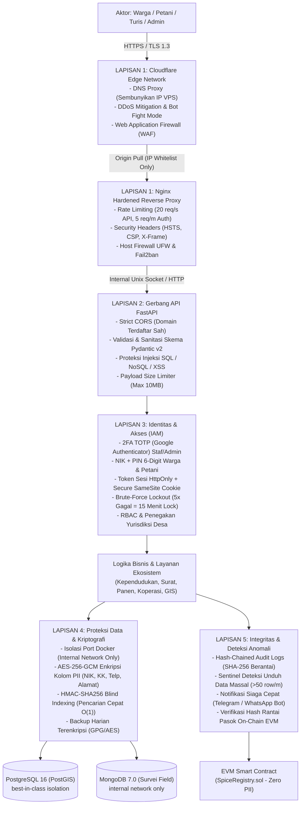
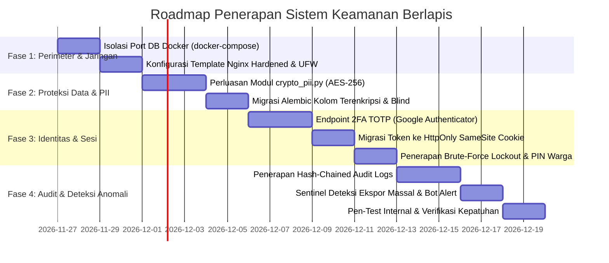

# Rancang Bangun Sistem Keamanan Berlapis (Defense-in-Depth)
**Ekosistem Digital Kepulauan Banda Neira (`Banda Digital Ecosystem / BTS-NEIRA`)**

---

## 1. Ringkasan Eksekutif & Filosofi Keamanan

Aplikasi **Ekosistem Digital Kepulauan Banda Neira** mengelola aset digital yang sangat berharga dan berisiko tinggi:
1. **Data Kependudukan Warga**: Meliputi Nomor Induk Kependudukan (NIK), Nomor Kartu Keluarga (KK), nomor telepon/WhatsApp, alamat tempat tinggal, serta dokumen administrasi surat desa warga (tunduk pada regulasi **UU Perlindungan Data Pribadi No. 27/2022**).
2. **Kedaulatan Ekonomi & Pangan**: Data transaksi keuangan Koperasi Hatta, kuota air bersih RO, saldo nasabah bank sampah, serta data tonase panen petani pala dan fuli.
3. **Integritas Rantai Pasok Rempah (Geographical Indication)**: Sertifikat Indikasi Geografis (GI) Pala Banda yang terikat dengan hash konsensus smart contract blockchain EVM.
4. **Keberlangsungan Pelayanan Publik**: Operasional harian kantor desa, pemesanan homestay ramah lingkungan (*eco-stay*), dan pendataan survei sosial ekonomi lapangan.

Untuk melindungi seluruh aset tersebut dari ancaman internal maupun eksternal, sistem ini mengadopsi filosofi **Defense-in-Depth (Keamanan Berlapis)** dengan prinsip:
- **Zero-Trust Perimeter**: Tidak ada entitas—baik dari luar internet maupun jaringan internal—yang dipercaya secara otomatis tanpa verifikasi ketat.
- **Privacy by Design**: Data pribadi tidak pernah disimpan dalam bentuk teks polos (*plaintext*) dan tidak pernah diunggah ke blockchain.
- **Archipelagic Usability**: Mekanisme keamanan tidak boleh merusak pengalaman pengguna lokal (warga dan petani) di kepulauan terluar dengan koneksi seluler fluktuatif.

---

## 2. Catatan Keputusan Arsitektur (*Architectural Decision Log*)

Hasil sesi *brainstorming* terstruktur menghasilkan 6 pilar keputusan strategis:

| ID | Dimensi Keamanan | Keputusan yang Disepakati | Alternatif Ditolak | Justifikasi Strategis |
|---|---|---|---|---|
| **D1** | **Cakupan Sistem** | *End-to-End Defense-in-Depth* (Semua Lapisan 1 s.d 5) | Parsial / Lapisan luar saja | Perlindungan holistik dari serangan internet (DDoS/Injeksi) hingga kebocoran basis data (*data breach*) internal. |
| **D2** | **Target Lingkungan** | Cloud VPS Publik (Ubuntu) + Domain Resmi + Nginx + Cloudflare | On-Premise Desa / Intranet Murni | Memastikan aksesibilitas global untuk verifikasi QR wisatawan dan ketersediaan tinggi (*high availability*). |
| **D3** | **Manajemen Identitas (IAM)** | *Tiered MFA* (TOTP Admin + PIN 6-Digit Warga + HttpOnly Cookie) | 2FA TOTP untuk semua warga | Memberikan keamanan perbankan bagi pengelola data desa tanpa membebani warga desa dengan aplikasi autentikator rumit. |
| **D4** | **Proteksi Basis Data** | Isolasi Port Kontainer 100% + Enkripsi PII AES-256-GCM + Backup Terenkripsi | Port DB terbuka / Plaintext DB | Kepatuhan mutlak UU PDP No. 27/2022 dan pencegahan total pemindaian port (*port scanning*) dari internet. |
| **D5** | **Perimeter Jaringan** | Cloudflare Edge (WAF/DDoS) + Nginx Hardened Reverse Proxy + UFW & Fail2ban | Nginx polos tanpa WAF Cloudflare | Menyamarkan IP asli VPS, menyerap serangan DDoS, memblokir bot jahat, dan menegakkan *Rate Limiting*. |
| **D6** | **Integritas & Audit** | Audit Trail Kriptografis Berantai (*Hash Chain*) + Deteksi Anomali + Bot Alert | Audit log standar tanpa hash berantai | Menjamin catatan audit tidak bisa dimanipulasi (*anti-tamper*) dan deteksi cepat jika terjadi eksfiltrasi data massal. |

---

## 3. Arsitektur Pertahanan 5 Lapisan (*5-Layer Defense-in-Depth*)



---

## 4. Rincian Teknis Implementasi Per Lapisan

### 4.1 Lapisan 1: Perimeter Jaringan & Infrastruktur Server

#### A. Konfigurasi Cloudflare Edge
- **DNS Proxying**: Seluruh *A-Record* domain diproxy (`Orange Cloud Active`) agar alamat IP publik VPS asli tidak terekspos ke publik.
- **Enkripsi SSL/TLS**: Mode `Full (Strict)` dengan sertifikat Cloudflare Origin CA yang dipasang pada Nginx VPS.
- **WAF & DDoS Mitigation**: Mengaktifkan *Bot Fight Mode*, proteksi otomatis terhadap *HTTP Flood / Layer 7 DDoS*, dan *Managed WAF Ruleset* untuk memblokir pola eksploitasi umum (*Log4j, SQLi, XSS, Path Traversal*).

#### B. Nginx Hardened Reverse Proxy
Konfigurasi Nginx diatur untuk hanya menerima koneksi dari rentang IP resmi Cloudflare dan menolak koneksi langsung ke IP VPS:
```nginx
# Restriksi: Hanya terima trafik dari Cloudflare Reverse Proxy
set_real_ip_from 173.245.48.0/20;
set_real_ip_from 103.21.244.0/22;
set_real_ip_from 103.22.200.0/22;
set_real_ip_from 103.31.4.0/22;
# ... (Rentang IP resmi Cloudflare lainnya)
real_ip_header CF-Connecting-IP;

# Rate Limiting Zones
limit_req_zone $binary_remote_addr zone=api_general:10m rate=20r/s;
limit_req_zone $binary_remote_addr zone=api_auth:10m rate=5r/m;

server {
    listen 443 ssl http2;
    server_name banda.neira.id; # Domain resmi

    # Security Headers Wajib (A+ Security Rating)
    add_header Strict-Transport-Security "max-age=31536000; includeSubDomains; preload" always;
    add_header X-Content-Type-Options "nosniff" always;
    add_header X-Frame-Options "DENY" always;
    add_header X-XSS-Protection "1; mode=block" always;
    add_header Referrer-Policy "strict-origin-when-cross-origin" always;
    add_header Content-Security-Policy "default-src 'self'; script-src 'self' 'unsafe-inline'; style-src 'self' 'unsafe-inline'; img-src 'self' data: https:; font-src 'self'; connect-src 'self' https:;" always;

    # Endpoint Login & Otentikasi
    location /api/v1/auth/ {
        limit_req zone=api_auth burst=3 nodelay;
        proxy_pass http://127.0.0.1:8005;
        proxy_set_header Host $host;
        proxy_set_header X-Real-IP $remote_addr;
    }

    # Endpoint API Umum
    location /api/ {
        limit_req zone=api_general burst=15 nodelay;
        proxy_pass http://127.0.0.1:8005;
        proxy_set_header Host $host;
        proxy_set_header X-Real-IP $remote_addr;
    }
}
```

#### C. Isolasi Port Kontainer Docker (`docker-compose.yml`)
Menghapus paparan port basis data ke host `0.0.0.0` sehingga port 5432 dan 27017 tidak dapat diakses dari internet:
```yaml
services:
  db:
    image: postgis/postgis:16-3.4
    container_name: banda_db
    restart: unless-stopped
    # HAPUS ATAU HANYA BIND KE 127.0.0.1 JIKA UNTUK DEBUGGING LOKAL:
    # ports:
    #   - "127.0.0.1:5435:5432"  <-- Hanya jika mutlak diperlukan oleh admin via SSH Tunnel
    networks:
      - banda_internal_network

  mongodb:
    image: mongo:7.0
    container_name: banda_mongodb
    restart: unless-stopped
    networks:
      - banda_internal_network

  backend:
    build:
      context: ./backend
    networks:
      - banda_internal_network
      - banda_web_network

networks:
  banda_internal_network:
    internal: true # Mencegah akses internet langsung ke basis data
  banda_web_network:
```

#### D. Pengerasan Host OS (UFW & Fail2ban)
- **Firewall UFW**:
  ```bash
  sudo ufw default deny incoming
  sudo ufw default allow outgoing
  sudo ufw allow 22/tcp comment 'SSH Port'
  sudo ufw allow 80/tcp comment 'HTTP for Let-Encrypt/Cloudflare'
  sudo ufw allow 443/tcp comment 'HTTPS Reverse Proxy'
  sudo ufw enable
  ```
- **Fail2ban**: Mengaktifkan modul proteksi SSH (`jail.local`) dengan batas 3 kali salah password $\rightarrow$ blokir IP penyerang selama 24 jam.
- **Kunci SSH**: Menonaktifkan login kata sandi root (`PermitRootLogin prohibit-password`, `PasswordAuthentication no`).

---

### 4.2 Lapisan 2: Gerbang API & Keamanan Aplikasi

1. **CORS Policy Ketat Tanpa Wildcard (`*`)**:
   - Di lingkungan produksi, `allow_origins` pada FastAPI hanya mencantumkan domain resmi aplikasi (misal: `https://banda.neira.id` dan `https://app.banda.neira.id`).
   - `allow_credentials=True` diproteksi ketat agar origin asing tidak dapat mengeksekusi *credentialed cross-site requests*.
2. **Validasi & Sanitasi Data Masukan (Pydantic v2)**:
   - Seluruh payload HTTP wajib tervalidasi skemanya dengan Pydantic v2.
   - Menggunakan *custom validators* untuk membersihkan karakter injeksi SQL, tag HTML/JavaScript (`<script>`, `<iframe>`), serta regex ketat untuk parameter NIK (harus tepat 16 digit numerik).
3. **Pembatasan Ukuran & Tipe Berkas Unggahan**:
   - Berkas lampiran permohonan surat warga (KTP, KK, Surat Pengantar) dibatasi maksimal **5 MB**.
   - Verifikasi *Magic Number* (MIME-Type fisik file seperti `image/jpeg`, `image/png`, `application/pdf`), menolak ekstensi yang dieksekusi sebagai skrip (`.php`, `.sh`, `.exe`, `.py`).

---

### 4.3 Lapisan 3: Identitas, Akses & Manajemen Sesi (IAM)

#### A. Strategi Otentikasi Bertingkat (*Tiered Security Model*)

| Kelompok Pengguna | Metode Otentikasi Utama | Lapisan Kedua (2FA / PIN) | Kebijakan Kegagalan Login |
|---|---|---|---|
| **Administrator Sistem** | Username + Password Kuat ($\ge 12$ Karakter) | **Wajib 2FA TOTP** (Google Authenticator / RFC 6238) | Salah 5 kali berturut-turut $\rightarrow$ Akun terkunci otomatis selama 15 menit + Alert ke Telegram. |
| **Perangkat Desa / Staf** | Username / NIK + Password Kuat ($\ge 10$ Karakter) | **Wajib 2FA TOTP** saat mengakses menu kependudukan & persetujuan surat | Salah 5 kali $\rightarrow$ Akun terkunci otomatis 15 menit. |
| **Operator Koperasi & Wisata**| Username + Password Standar | Verifikasi sesi aktif + konfirmasi PIN transaksi kasir | Salah 5 kali $\rightarrow$ Kunci sementara 15 menit. |
| **Warga Desa & Petani** | NIK 16-Digit Terdaftar | **PIN 6-Digit Mandiri** (dibuat saat pertama verifikasi) | Salah 3 kali $\rightarrow$ Kunci 10 menit (mencegah *PIN brute-force*). |
| **Wisatawan / Publik** | Tanpa Login (Akses Publik Etalase & QR) / Email Magic Link jika reservasi | Token Verifikasi Publik Acak (*Cryptographic Nonce*) | Rate limit per IP. |

#### B. Pengamanan Token Sesi (*Anti-XSS Session Hardening*)
- **Migrasi ke HttpOnly Cookies**: Token JWT `access_token` dan `refresh_token` tidak lagi disimpan di `localStorage` peramban (yang rentan dibaca oleh serangan Cross-Site Scripting / XSS).
- Token dikirimkan oleh backend melalui header respons:
  ```http
  Set-Cookie: access_token=eyJh...; Path=/; HttpOnly; Secure; SameSite=Strict; Max-Age=900
  Set-Cookie: refresh_token=dGhp...; Path=/api/v1/auth/refresh; HttpOnly; Secure; SameSite=Strict; Max-Age=604800
  ```
- **Rotasi Refresh Token**: Setiap kali `refresh_token` digunakan untuk memperbarui `access_token`, *refresh token* lama langsung dicabut (*invalidated*) dan diganti dengan token baru (*Token Rotation Family*).

#### C. Penegakan Batas Yurisdiksi Desa (*Territorial ABAC*)
- Staf desa dari Desa Diera **hanya dapat melihat dan memverifikasi data warga Desa Diera**.
- Mencoba mengakses data warga desa lain via manipulasi ID endpoint (*Insecure Direct Object Reference / IDOR*) akan memicu status `403 Forbidden` dan langsung dicatat ke dalam log pelanggaran keamanan (*Security Incident*).

---

### 4.4 Lapisan 4: Proteksi Data Sensitif & Kriptografi (*Data at Rest*)

#### A. Arsitektur Kriptografi Kolom PII (UU PDP No. 27/2022)
Melanjutkan fondasi yang telah dibangun pada [crypto_nik.py](file:///home/hid/Projects/BTS-NEIRA/penduduk/backend/app/core/crypto_nik.py), proteksi diperluas ke seluruh atribut data sensitif warga:

1. **AES-256-GCM (Authenticated Encryption)**:
   - Digunakan untuk mengenkripsi kolom: `nik`, `kk_number`, `phone_number`, `address_detail`, dan `birth_date`.
   - Menggunakan *Initialization Vector (IV/Nonce)* 12-byte acak yang unik untuk setiap baris data sehingga data yang sama tidak akan menghasilkan *ciphertext* yang identik.
2. **Blind Indexing HMAC-SHA256 (Pencarian Cepat $O(1)$ Tanpa Dekripsi)**:
   - Kolom `nik_blind_index` dan `phone_blind_index` dihitung menggunakan `HMAC-SHA256(value, BLIND_INDEX_SALT)`.
   - Backend dapat mencari data spesifik warga melalui kueri SQL indeks biasa (`SELECT * FROM residents WHERE nik_blind_index = :hash`) dengan kecepatan tinggi tanpa perlu mendekripsi seluruh tabel.
3. **Data Masking di Sisi Frontend**:
   - Seluruh data NIK yang ditampilkan di layar seluler otomatis disensor (contoh: `8101************`), kecuali jika Administrator mengklik tombol lihat detail dengan otentikasi ulang.

#### B. Prosedur Pencadangan Terenkripsi Otomatis (*Encrypted Disaster Recovery*)
Skrip cron otomatis harian dijalankan di server VPS untuk mengamankan data:
1. `pg_dump` menghasilkan arsip basis data secara internal.
2. Arsip dikompresi dan dienkripsi langsung menggunakan **GPG (AES-256 cipher)** dengan kunci privat terpisah.
3. Berkas backup terenkripsi (`banda_backup_YYYYMMDD.sql.gz.gpg`) disinkronkan ke penyimpanan cadangan terisolasi (*off-site cloud bucket*) dan salinan lokal dipertahankan selama 7 hari.

---

### 4.5 Lapisan 5: Integritas Audit, Blockchain & Deteksi Anomali

#### A. *Hash-Chained Audit Logs* (Pencatatan Audit Anti-Manipulasi)
Tabel log audit dimodernisasi agar setiap baris log baru mengikat hash dari baris log sebelumnya, membentuk rantai integritas (*micro-blockchain* di database):
```sql
-- Skema Konseptual Hash-Chained Audit Log
CREATE TABLE secure_audit_logs (
    id BIGSERIAL PRIMARY KEY,
    timestamp TIMESTAMPTZ NOT NULL DEFAULT NOW(),
    actor_id UUID NOT NULL,
    actor_role VARCHAR(50) NOT NULL,
    action VARCHAR(100) NOT NULL,
    target_entity VARCHAR(100) NOT NULL,
    target_id VARCHAR(100) NOT NULL,
    delta_payload JSONB,
    previous_log_hash VARCHAR(64) NOT NULL, -- Hash dari record log (id - 1)
    current_log_hash VARCHAR(64) NOT NULL   -- SHA256(id + timestamp + actor + action + delta + previous_hash)
);
```
*Dampak*: Jika seseorang membobol database dan mencoba mengubah atau menghapus satu baris log audit di masa lalu, rantai hash akan putus (*integrity check failure*), dan sistem akan langsung menandai adanya manipulasi ilegal.

#### B. Sentinel Deteksi Anomali & Akses Data Massal
Sistem latar belakang (*Background Monitor*) memantau pola kueri pengguna:
- **Deteksi Ekfiltrasi Massal**: Jika sebuah akun mengekspor atau melihat lebih dari **50 data profil warga dalam rentang 1 menit**, sesi akun tersebut langsung dibekukan sementara dan status siaga merah diaktifkan.
- **Deteksi Akses Lokasi Tak Lazim**: Login akun staf desa dari luar wilayah Indonesia atau zona IP yang mencurigakan akan langsung meminta konfirmasi 2FA ulang.

#### C. Bot Peringatan Siaga Keamanan (*Instant Security Alert*)
Setiap insiden keamanan level tinggi akan langsung mengirimkan pesan siaga terenkripsi ke **Telegram Bot / WhatsApp Resmi Admin Sistem**:
- Contoh Notifikasi:
  > 🚨 **PERINGATAN KEAMANAN SISTEM BANDA NEIRA**  
  > **Jenis Insiden**: Percobaan Brute Force Login Terdeteksi  
  > **Target Akun**: `admin_desa_diera`  
  > **Alamat IP**: `103.x.x.x` (Origin: Jakarta)  
  > **Aksi Sistem**: Akun dikunci otomatis selama 15 menit. IP masuk daftar pantau Nginx.

---

## 5. Rencana Penerapan Bertahap (*Progressive Implementation Roadmap*)

Sesuai strategi **Pendekatan 1 (*Progressive Modular Hardening*)**, rencana kerja dibagi menjadi 4 fase yang dapat dieksekusi secara terukur tanpa risiko merusak sistem:



### Rincian Tiap Fase:
1. **Fase 1: Perimeter Jaringan & Isolasi Kontainer**
   - Mengubah `docker-compose.yml` untuk memutus akses port 5432 & 27017 dari host publik.
   - Menyediakan berkas konfigurasi `nginx.conf.template` dengan aturan Cloudflare dan security headers lengkap.
   - Menyusun skrip inisialisasi firewall host Linux (`setup_firewall.sh`).
2. **Fase 2: Perluasan Enkripsi PII & Kepatuhan UU PDP**
   - Mengembangkan modul `crypto_pii.py` untuk mengenkripsi nomor telepon, alamat, dan nomor KK.
   - Menghasilkan migrasi database Alembic yang aman (*data migration script*) untuk mengenkripsi data warga yang sudah ada.
   - Memastikan seluruh endpoint API mengembalikan data tersensor (*masked PII*) secara default.
3. **Fase 3: Penguatan Identitas, 2FA TOTP & Cookie Sesi**
   - Menambahkan dependensi `pyotp` dan `qrcode` di backend untuk pendaftaran dan verifikasi 2FA TOTP.
   - Menambahkan rute `/api/v1/auth/2fa/setup` dan `/api/v1/auth/2fa/verify`.
   - Memperbarui pengiriman token login menggunakan `response.set_cookie(...)` berparameter `httponly=True, secure=True, samesite="strict"`.
   - Mengaktifkan proteksi penguncian akun otomatis setelah 5 kali gagal login.
4. **Fase 4: Integritas Audit Berantai & Sentinel Deteksi Anomali**
   - Memodifikasi model `AuditLog` di PostgreSQL dengan kolom `previous_hash` dan `current_hash`.
   - Menulis *listener middleware* untuk menghitung hash berantai otomatis saat terjadi mutasi data.
   - Menambahkan *sentinel checker* untuk mendeteksi penarikan data kependudukan dalam jumlah besar.
   - Menghubungkan webhook notifikasi ke bot Telegram/WhatsApp administrator.

---

## 6. Matriks Verifikasi & Kepatuhan (*Quality & Compliance Matrix*)

| Standar Keamanan / Regulasi | Target Kepatuhan | Status Kesiapan dalam Desain |
|---|---|---|
| **UU PDP No. 27/2022 Pasal 35 & 39** | Kewajiban menjaga kerahasiaan data pribadi dari kebocoran melalui enkripsi dan audit berkala. | **Terpenuhi Penuh**: Enkripsi AES-256-GCM pada seluruh PII + Log audit berantai anti-tamper. |
| **OWASP Top 10 - A01: Broken Access Control** | Pencegahan akses data lintas desa / eskalasi hak istimewa (IDOR). | **Terpenuhi Penuh**: Penegakan Yurisdiksi Desa berbasis token JWT + validasi backend. |
| **OWASP Top 10 - A02: Cryptographic Failures** | Pencegahan penyimpanan kata sandi/data sensitif tanpa enkripsi kuat. | **Terpenuhi Penuh**: Bcrypt 12 rounds untuk kata sandi, AES-256-GCM + HMAC-SHA256 untuk data pribadi. |
| **OWASP Top 10 - A03: Injection (SQLi/XSS)** | Pembersihan input data dari skrip berbahaya. | **Terpenuhi Penuh**: SQLAlchemy parameterized queries + validasi skema Pydantic v2. |
| **OWASP Top 10 - A07: Identification & Auth Failures** | Pencegahan brute-force dan pencurian token sesi. | **Terpenuhi Penuh**: 2FA TOTP, *Account Lockout* (5x gagal), dan *HttpOnly Cookie*. |
| **ISO/IEC 27001 Annex A.12** | Keamanan operasional, pencadangan data, dan isolasi jaringan. | **Terpenuhi Penuh**: Docker internal network, backup terenkripsi GPG harian, dan Cloudflare WAF. |

---

## 7. Kesimpulan & Langkah Lanjutan

Dokumen perencanaan [rancangan_kemanan_berlapis.md](file:///home/hid/Projects/BTS-NEIRA/penduduk/rancangan_kemanan_berlapis.md) ini telah mengunci arsitektur pertahanan menyeluruh dari gerbang jaringan terluar hingga tingkat bit data pribadi di basis data.

Dengan pendekatan **Progressive Modular Hardening**, seluruh peningkatan keamanan ini siap diimplementasikan secara berurutan dan teratur, menjamin bahwa **Ekosistem Digital Kepulauan Banda Neira** tidak hanya fungsional dan ramah pengguna, tetapi juga memiliki ketahanan siber sekelas institusi perbankan dan kedaulatan data yang kokoh.
